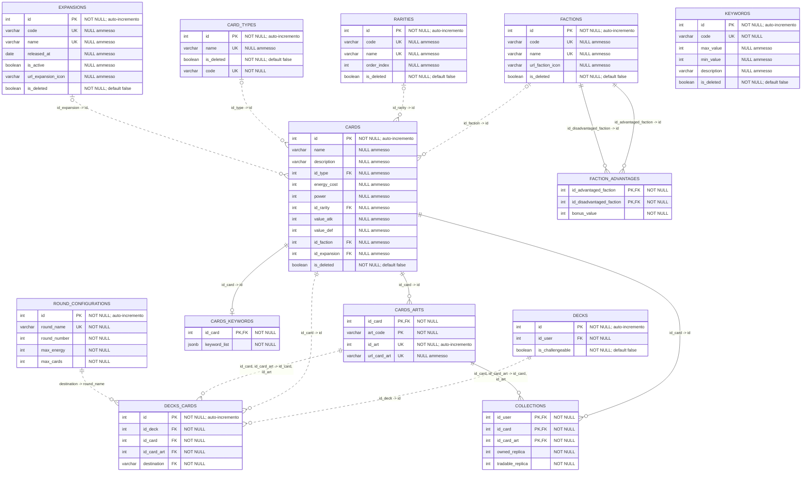
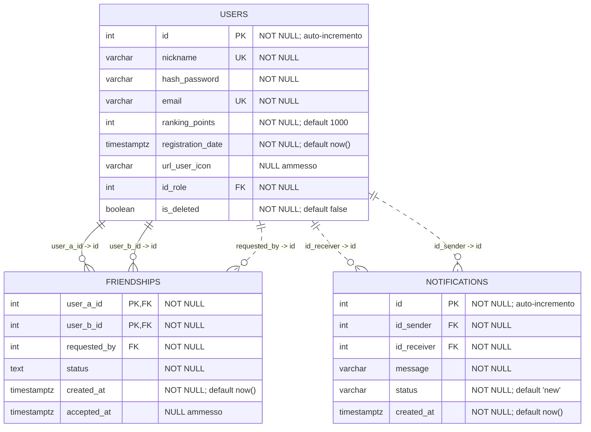
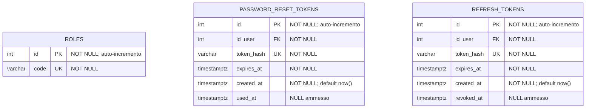
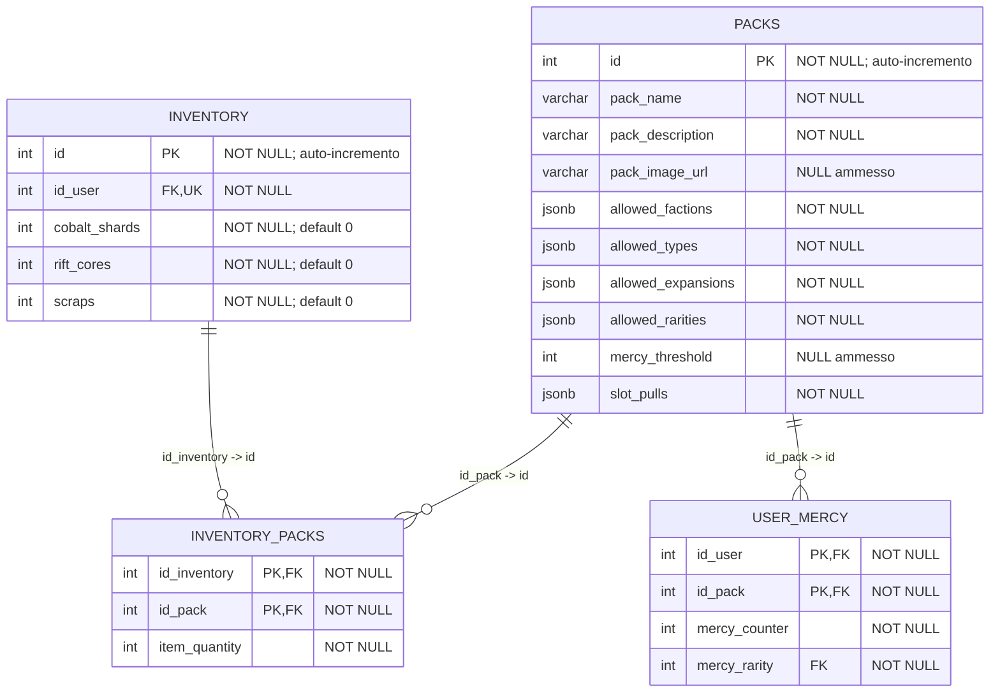
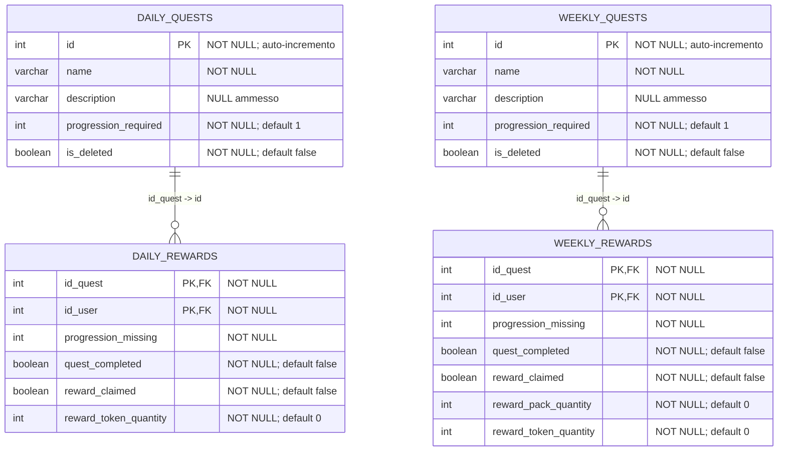
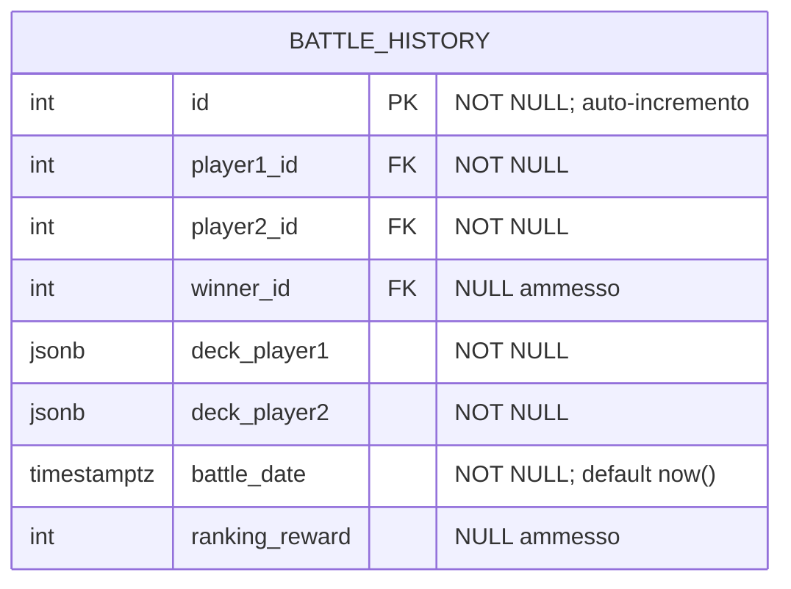
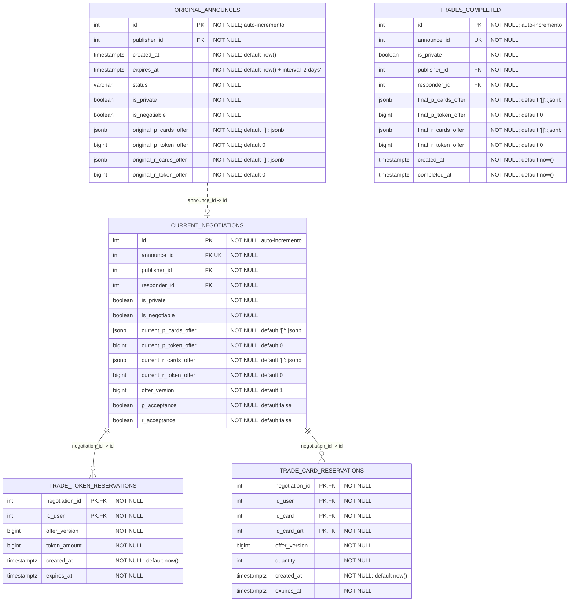

# Specifica della base di dati — v1.1

**Versione:** v1.1. **Ultimo aggiornamento:** 2026-11-09. **Motore del modello:** PostgreSQL 18. Implementazione e migrazioni: non eseguite. Aggiornamento corrente: inventario con Scaglie, Nuclei Rift e Rotami e sistema mercy per aperture del pacchetto corrispondente; rimozione dei campi anagrafici dell’utente e conferma della durata degli scambi a due giorni, su istruzione dell’utente del 2026-11-09.

Questo documento è la fonte canonica e autonoma della struttura della base di dati, dei vincoli dichiarati e delle responsabilità applicative associate. Le decisioni mancanti sono elencate qui e restano **DA DEFINIRE**; nessun altro documento è necessario per interpretare lo schema. La rappresentazione completa equivalente in DBML è [db_schema-v1.1.dbml](db_schema-v1.1.dbml).

**Identificativi.** Tutti gli identificativi di entità e tutti i relativi riferimenti sono `int`. Le colonne autonome `id` e l'identificativo univoco `CARDS_ARTS.id_art` sono generati dal database con auto-incremento, rappresentato da `increment` nel DBML. Le FK, gli identificativi ereditati e le componenti delle PK associative ricevono invece gli ID dei record già esistenti, senza una sequenza propria. Questo vale anche per `CARDS_KEYWORDS.id_card` e per l'identificativo storico `TRADES_COMPLETED.announce_id`. Le PK associative restano semplici o composte secondo i diagrammi. Un ID generato non esprime un ordine temporale affidabile e la numerazione non è necessariamente consecutiva. L'applicazione usa interi positivi nel dominio di `int`; gli ID non sostituiscono i controlli di autorizzazione.

**Nomi e date.** Tabelle in `UPPER_SNAKE_CASE`, colonne in `lower_snake_case`. Gli istanti sono `timestamptz`; connessioni e serializzazione usano UTC e la visualizzazione applica il fuso desiderato. Le date senza orario, come `EXPANSIONS.released_at`, usano `date`.

**Legenda.** `PK` è una chiave primaria, anche composta; `FK` una relazione dichiarata; `UK` l'unicità della colonna. I commenti riportano nullabilità, default e auto-incremento. `||` indica esattamente uno, `o|`/`|o` zero o uno e `o{`/`}o` zero o molti. La linea è continua se la FK appartiene alla PK dipendente, tratteggiata negli altri casi. Ogni tabella compare nello schema integrale e in una sola sezione di dettaglio; le relazioni esterne ai dettagli compaiono nello schema integrale.

**Confine delle garanzie.** PK, FK, unicità e `CHECK` sono vincoli del modello; note, protocolli e validazioni backend descrivono il comportamento da implementare. Non attestano l'esistenza di trigger, servizi, API o migrazioni già eseguiti.

### Schema integrale

```mermaid
erDiagram
    ROLES {
        int id PK "NOT NULL; auto-incremento"
        varchar code UK "NOT NULL"
    }
    PASSWORD_RESET_TOKENS {
        int id PK "NOT NULL; auto-incremento"
        int id_user FK "NOT NULL"
        varchar token_hash UK "NOT NULL"
        timestamptz expires_at "NOT NULL"
        timestamptz created_at "NOT NULL; default now()"
        timestamptz used_at "NULL ammesso"
    }
    REFRESH_TOKENS {
        int id PK "NOT NULL; auto-incremento"
        int id_user FK "NOT NULL"
        varchar token_hash UK "NOT NULL"
        timestamptz expires_at "NOT NULL"
        timestamptz created_at "NOT NULL; default now()"
        timestamptz revoked_at "NULL ammesso"
    }
    USERS {
        int id PK "NOT NULL; auto-incremento"
        varchar nickname UK "NOT NULL"
        varchar hash_password "NOT NULL"
        varchar email UK "NOT NULL"
        int ranking_points "NOT NULL; default 1000"
        timestamptz registration_date "NOT NULL; default now()"
        varchar url_user_icon "NULL ammesso"
        int id_role FK "NOT NULL"
        boolean is_deleted "NOT NULL; default false"
    }
    DECKS {
        int id PK "NOT NULL; auto-incremento"
        int id_user FK "NOT NULL"
        boolean is_challengeable "NOT NULL; default false"
    }
    FACTIONS {
        int id PK "NOT NULL; auto-incremento"
        varchar code UK "NULL ammesso"
        varchar name UK "NULL ammesso"
        varchar url_faction_icon "NULL ammesso"
        boolean is_deleted "NOT NULL; default false"
    }
    CARDS {
        int id PK "NOT NULL; auto-incremento"
        varchar name "NULL ammesso"
        varchar description "NULL ammesso"
        int id_type FK "NULL ammesso"
        int energy_cost "NULL ammesso"
        int power "NULL ammesso"
        int id_rarity FK "NULL ammesso"
        int value_atk "NULL ammesso"
        int value_def "NULL ammesso"
        int id_faction FK "NULL ammesso"
        int id_expansion FK "NULL ammesso"
        boolean is_deleted "NOT NULL; default false"
    }
    RARITIES {
        int id PK "NOT NULL; auto-incremento"
        varchar code UK "NULL ammesso"
        varchar name UK "NULL ammesso"
        int order_index "NULL ammesso"
        boolean is_deleted "NOT NULL; default false"
    }
    EXPANSIONS {
        int id PK "NOT NULL; auto-incremento"
        varchar code UK "NULL ammesso"
        varchar name UK "NULL ammesso"
        date released_at "NULL ammesso"
        boolean is_active "NULL ammesso"
        varchar url_expansion_icon "NULL ammesso"
        boolean is_deleted "NOT NULL; default false"
    }
    CARD_TYPES {
        int id PK "NOT NULL; auto-incremento"
        varchar name UK "NULL ammesso"
        boolean is_deleted "NOT NULL; default false"
        varchar code UK "NOT NULL"
    }
    KEYWORDS {
        int id PK "NOT NULL; auto-incremento"
        varchar code UK "NOT NULL"
        int max_value "NULL ammesso"
        int min_value "NULL ammesso"
        varchar description "NULL ammesso"
        boolean is_deleted "NOT NULL; default false"
    }
    NOTIFICATIONS {
        int id PK "NOT NULL; auto-incremento"
        int id_sender FK "NOT NULL"
        int id_receiver FK "NOT NULL"
        varchar message "NOT NULL"
        varchar status "NOT NULL; default 'new'"
        timestamptz created_at "NOT NULL; default now()"
    }
    CARDS_KEYWORDS {
        int id_card PK,FK "NOT NULL"
        jsonb keyword_list "NOT NULL"
    }
    DECKS_CARDS {
        int id PK "NOT NULL; auto-incremento"
        int id_deck FK "NOT NULL"
        int id_card FK "NOT NULL"
        int id_card_art FK "NOT NULL"
        varchar destination FK "NOT NULL"
    }
    ROUND_CONFIGURATIONS {
        int id PK "NOT NULL; auto-incremento"
        varchar round_name UK "NOT NULL"
        int round_number "NOT NULL"
        int max_energy "NOT NULL"
        int max_cards "NOT NULL"
    }
    COLLECTIONS {
        int id_user PK,FK "NOT NULL"
        int id_card PK,FK "NOT NULL"
        int id_card_art PK,FK "NOT NULL"
        int owned_replica "NOT NULL"
        int tradable_replica "NOT NULL"
    }
    INVENTORY {
        int id PK "NOT NULL; auto-incremento"
        int id_user FK,UK "NOT NULL"
        int cobalt_shards "NOT NULL; default 0"
        int rift_cores "NOT NULL; default 0"
        int scraps "NOT NULL; default 0"
    }
    PACKS {
        int id PK "NOT NULL; auto-incremento"
        varchar pack_name "NOT NULL"
        varchar pack_description "NOT NULL"
        varchar pack_image_url "NULL ammesso"
        jsonb allowed_factions "NOT NULL"
        jsonb allowed_types "NOT NULL"
        jsonb allowed_expansions "NOT NULL"
        jsonb allowed_rarities "NOT NULL"
        int mercy_threshold "NULL ammesso"
        jsonb slot_pulls "NOT NULL"
    }
    USER_MERCY {
        int id_user PK,FK "NOT NULL"
        int id_pack PK,FK "NOT NULL"
        int mercy_counter "NOT NULL"
        int mercy_rarity FK "NOT NULL"
    }
    INVENTORY_PACKS {
        int id_inventory PK,FK "NOT NULL"
        int id_pack PK,FK "NOT NULL"
        int item_quantity "NOT NULL"
    }
    BATTLE_HISTORY {
        int id PK "NOT NULL; auto-incremento"
        int player1_id FK "NOT NULL"
        int player2_id FK "NOT NULL"
        int winner_id FK "NULL ammesso"
        jsonb deck_player1 "NOT NULL"
        jsonb deck_player2 "NOT NULL"
        timestamptz battle_date "NOT NULL; default now()"
        int ranking_reward "NULL ammesso"
    }
    DAILY_QUESTS {
        int id PK "NOT NULL; auto-incremento"
        varchar name "NOT NULL"
        varchar description "NULL ammesso"
        int progression_required "NOT NULL; default 1"
        boolean is_deleted "NOT NULL; default false"
    }
    WEEKLY_QUESTS {
        int id PK "NOT NULL; auto-incremento"
        varchar name "NOT NULL"
        varchar description "NULL ammesso"
        int progression_required "NOT NULL; default 1"
        boolean is_deleted "NOT NULL; default false"
    }
    DAILY_REWARDS {
        int id_quest PK,FK "NOT NULL"
        int id_user PK,FK "NOT NULL"
        int progression_missing "NOT NULL"
        boolean quest_completed "NOT NULL; default false"
        boolean reward_claimed "NOT NULL; default false"
        int reward_token_quantity "NOT NULL; default 0"
    }
    WEEKLY_REWARDS {
        int id_quest PK,FK "NOT NULL"
        int id_user PK,FK "NOT NULL"
        int progression_missing "NOT NULL"
        boolean quest_completed "NOT NULL; default false"
        boolean reward_claimed "NOT NULL; default false"
        int reward_pack_quantity "NOT NULL; default 0"
        int reward_token_quantity "NOT NULL; default 0"
    }
    FACTION_ADVANTAGES {
        int id_advantaged_faction PK,FK "NOT NULL"
        int id_disadvantaged_faction PK,FK "NOT NULL"
        int bonus_value "NOT NULL"
    }
    FRIENDSHIPS {
        int user_a_id PK,FK "NOT NULL"
        int user_b_id PK,FK "NOT NULL"
        int requested_by FK "NOT NULL"
        text status "NOT NULL"
        timestamptz created_at "NOT NULL; default now()"
        timestamptz accepted_at "NULL ammesso"
    }
    ORIGINAL_ANNOUNCES {
        int id PK "NOT NULL; auto-incremento"
        int publisher_id FK "NOT NULL"
        timestamptz created_at "NOT NULL; default now()"
        timestamptz expires_at "NOT NULL; default now() + interval '2 days'"
        varchar status "NOT NULL"
        boolean is_private "NOT NULL"
        boolean is_negotiable "NOT NULL"
        jsonb original_p_cards_offer "NOT NULL; default '[]'::jsonb"
        bigint original_p_token_offer "NOT NULL; default 0"
        jsonb original_r_cards_offer "NOT NULL; default '[]'::jsonb"
        bigint original_r_token_offer "NOT NULL; default 0"
    }
    CURRENT_NEGOTIATIONS {
        int id PK "NOT NULL; auto-incremento"
        int announce_id FK,UK "NOT NULL"
        int publisher_id FK "NOT NULL"
        int responder_id FK "NOT NULL"
        boolean is_private "NOT NULL"
        boolean is_negotiable "NOT NULL"
        jsonb current_p_cards_offer "NOT NULL; default '[]'::jsonb"
        bigint current_p_token_offer "NOT NULL; default 0"
        jsonb current_r_cards_offer "NOT NULL; default '[]'::jsonb"
        bigint current_r_token_offer "NOT NULL; default 0"
        bigint offer_version "NOT NULL; default 1"
        boolean p_acceptance "NOT NULL; default false"
        boolean r_acceptance "NOT NULL; default false"
    }
    TRADES_COMPLETED {
        int id PK "NOT NULL; auto-incremento"
        int announce_id UK "NOT NULL"
        boolean is_private "NOT NULL"
        int publisher_id FK "NOT NULL"
        int responder_id FK "NOT NULL"
        jsonb final_p_cards_offer "NOT NULL; default '[]'::jsonb"
        bigint final_p_token_offer "NOT NULL; default 0"
        jsonb final_r_cards_offer "NOT NULL; default '[]'::jsonb"
        bigint final_r_token_offer "NOT NULL; default 0"
        timestamptz created_at "NOT NULL; default now()"
        timestamptz completed_at "NOT NULL; default now()"
    }
    CARDS_ARTS {
        int id_card PK,FK "NOT NULL"
        varchar art_code PK "NOT NULL"
        int id_art UK "NOT NULL; auto-incremento"
        varchar url_card_art UK "NULL ammesso"
    }
    TRADE_TOKEN_RESERVATIONS {
        int negotiation_id PK,FK "NOT NULL"
        int id_user PK,FK "NOT NULL"
        bigint offer_version "NOT NULL"
        bigint token_amount "NOT NULL"
        timestamptz created_at "NOT NULL; default now()"
        timestamptz expires_at "NOT NULL"
    }
    TRADE_CARD_RESERVATIONS {
        int negotiation_id PK,FK "NOT NULL"
        int id_user PK,FK "NOT NULL"
        int id_card PK,FK "NOT NULL"
        int id_card_art PK,FK "NOT NULL"
        bigint offer_version "NOT NULL"
        int quantity "NOT NULL"
        timestamptz created_at "NOT NULL; default now()"
        timestamptz expires_at "NOT NULL"
    }
    ROLES ||..o{ USERS : "id_role -> id"
    USERS ||..o{ DECKS : "id_user -> id"
    FACTIONS |o..o{ CARDS : "id_faction -> id"
    RARITIES |o..o{ CARDS : "id_rarity -> id"
    CARD_TYPES |o..o{ CARDS : "id_type -> id"
    EXPANSIONS |o..o{ CARDS : "id_expansion -> id"
    CARDS ||--o| CARDS_KEYWORDS : "id_card -> id"
    DECKS ||..o{ DECKS_CARDS : "id_deck -> id"
    CARDS ||..o{ DECKS_CARDS : "id_card -> id"
    CARDS_ARTS ||..o{ DECKS_CARDS : "id_card, id_card_art -> id_card, id_art"
    ROUND_CONFIGURATIONS ||..o{ DECKS_CARDS : "destination -> round_name"
    USERS ||--o{ COLLECTIONS : "id_user -> id"
    CARDS ||--o{ COLLECTIONS : "id_card -> id"
    USERS ||--o{ FRIENDSHIPS : "user_a_id -> id"
    USERS ||--o{ FRIENDSHIPS : "user_b_id -> id"
    USERS ||..o{ FRIENDSHIPS : "requested_by -> id"
    USERS ||..o{ PASSWORD_RESET_TOKENS : "id_user -> id"
    USERS ||..o{ REFRESH_TOKENS : "id_user -> id"
    USERS ||..o| INVENTORY : "id_user -> id"
    INVENTORY ||--o{ INVENTORY_PACKS : "id_inventory -> id"
    PACKS ||--o{ INVENTORY_PACKS : "id_pack -> id"
    USERS ||--o{ USER_MERCY : "id_user -> id"
    PACKS ||--o{ USER_MERCY : "id_pack -> id"
    RARITIES ||..o{ USER_MERCY : "mercy_rarity -> id"
    USERS ||..o{ ORIGINAL_ANNOUNCES : "publisher_id -> id"
    ORIGINAL_ANNOUNCES ||..o| CURRENT_NEGOTIATIONS : "announce_id -> id"
    USERS ||..o{ CURRENT_NEGOTIATIONS : "publisher_id -> id"
    USERS ||..o{ CURRENT_NEGOTIATIONS : "responder_id -> id"
    USERS ||..o{ TRADES_COMPLETED : "publisher_id -> id"
    USERS ||..o{ TRADES_COMPLETED : "responder_id -> id"
    USERS ||..o{ BATTLE_HISTORY : "player1_id -> id"
    USERS ||..o{ BATTLE_HISTORY : "player2_id -> id"
    USERS |o..o{ BATTLE_HISTORY : "winner_id -> id"
    FACTIONS ||--o{ FACTION_ADVANTAGES : "id_advantaged_faction -> id"
    FACTIONS ||--o{ FACTION_ADVANTAGES : "id_disadvantaged_faction -> id"
    USERS ||..o{ NOTIFICATIONS : "id_receiver -> id"
    USERS ||..o{ NOTIFICATIONS : "id_sender -> id"
    USERS ||--o{ DAILY_REWARDS : "id_user -> id"
    DAILY_QUESTS ||--o{ DAILY_REWARDS : "id_quest -> id"
    USERS ||--o{ WEEKLY_REWARDS : "id_user -> id"
    WEEKLY_QUESTS ||--o{ WEEKLY_REWARDS : "id_quest -> id"
    CARDS ||--o{ CARDS_ARTS : "id_card -> id"
    CARDS_ARTS ||--o{ COLLECTIONS : "id_card, id_card_art -> id_card, id_art"
    CURRENT_NEGOTIATIONS ||--o{ TRADE_TOKEN_RESERVATIONS : "negotiation_id -> id"
    INVENTORY ||--o{ TRADE_TOKEN_RESERVATIONS : "id_user -> id_user"
    CURRENT_NEGOTIATIONS ||--o{ TRADE_CARD_RESERVATIONS : "negotiation_id -> id"
    USERS ||--o{ TRADE_CARD_RESERVATIONS : "id_user -> id"
    CARDS_ARTS ||--o{ TRADE_CARD_RESERVATIONS : "id_card, id_card_art -> id_card, id_art"
```



### Dettaglio struttura delle carte



**Catalogo.** `CARDS` conserva nome, descrizione, energia, potenza, attacco, difesa e classificazioni tramite FK nullable a `CARD_TYPES`, `RARITIES`, `FACTIONS` ed `EXPANSIONS`. I metadati di gioco sono nullable nel modello: il backend deve rifiutare una validazione o un'apertura che richieda dati mancanti. I codici di filtro sono `CARD_TYPES.code`, `FACTIONS.code`, `RARITIES.code` ed `EXPANSIONS.code`; solo il primo è anche obbligatorio. La coerenza del catalogo è verificata prima dell'uso. `EXPANSIONS.is_active` è distinto da `is_deleted`.

**Varianti grafiche.** `CARDS_ARTS` ha PK `(id_card, art_code)`, per esempio con codici `STANDARD` o `LV2`. `id_art` è un intero auto-incrementale, obbligatorio e univoco; `url_card_art` è univoco ma nullable. L'unicità composta `(id_card, id_art)` sostiene le FK composte di collezione, mazzi e prenotazioni e impedisce di associare un'arte alla carta sbagliata.

**Parole chiave.** `KEYWORDS` conserva codice obbligatorio univoco, limiti facoltativi `min_value`/`max_value`, descrizione e cancellazione logica. `CARDS_KEYWORDS.id_card` è l'unica PK ed è FK verso `CARDS.id`: ogni carta ha al massimo una riga. `keyword_list` è un JSONB obbligatorio, esterno alla PK, che rappresenta un array di oggetti `{keywordId, keywordValue}`. `keywordId` è un intero riferito logicamente a `KEYWORDS.id`, senza FK annidata. Il backend verifica forma, esistenza, identificativi non ripetuti e valori nel range applicabile; anche la coerenza fra i due limiti nullable è applicativa. La PK non impedisce duplicati interni al JSON.

**Vantaggi di fazione.** `FACTION_ADVANTAGES` usa la PK `(id_advantaged_faction, id_disadvantaged_faction)`, due FK verso `FACTIONS.id` e `bonus_value` obbligatorio. Il `CHECK` vieta la stessa fazione sui due lati. È ammesso un solo bonus per coppia ordinata, senza imporre simmetria.

**Mazzi e copie.** `DECKS.id_user` è obbligatorio; ogni utente può avere più mazzi. `is_challengeable` è obbligatorio con default `false`: se vero, il mazzo può essere selezionato dal matchmaking, ma deve comunque essere rivalidato. Ogni riga di `DECKS_CARDS` rappresenta una copia, con `id` intero auto-incrementale, carta, arte e destinazione obbligatorie. Non esiste un campo quantità né un vincolo univoco sulla combinazione mazzo/carta/arte/destinazione: due copie possono avere ID diversi. La FK composta `(id_card, id_card_art) → CARDS_ARTS.(id_card, id_art)` garantisce la coerenza della variante, non il suo possesso.

**Configurazioni dei round.** `ROUND_CONFIGURATIONS` conserva ID auto-incrementale, `round_name` obbligatorio univoco e interi obbligatori `round_number`, `max_energy`, `max_cards`, ciascuno maggiore di zero tramite `CHECK`. `DECKS_CARDS.destination` riferisce `round_name`. I nomi documentati sono `ROUND1` … `ROUND5` ed `EQUIPMENT`; non sono un enum o un dominio SQL chiuso. L'immutabilità delle configurazioni è una politica applicativa. Per ogni destinazione il backend verifica composizione, numero di carte entro `max_cards` e somma dei costi energetici entro `max_energy`. Valori iniziali, minimi di carte, trattamento degli equipaggiamenti e ulteriori limiti di potenza, copie e rarità restano da definire; non sono introdotti valori numerici impliciti.

**Collezione.** `COLLECTIONS` ha PK `(id_user, id_card, id_card_art)`, FK a utente, carta e coppia carta/arte, `owned_replica > 0` e `0 <= tradable_replica <= owned_replica`. Una tripla assente vale zero solo dopo una lettura riuscita. Il backend elimina la riga quando il possesso finale arriva a zero, dopo aver consumato o rilasciato le prenotazioni attive. Possesso e scambiabilità sono distinti per arte. Il mazzo non riferisce la riga volatile della collezione: il backend verifica le occorrenze per carta/arte e coordina trasferimenti e validità del mazzo. Il riutilizzo delle copie in più mazzi e la giocabilità delle copie prenotate restano aperti.

**Cancellazione e conversione.** I flag `is_deleted` dei cataloghi hanno default `false`. La cancellazione logica di carta o espansione richiede un servizio backend: invalidare annunci e trattative interessati, rilasciare tutti gli hold anche della controparte, quindi convertire le copie e ripulire collezione e mazzi. Non è un trigger e non comporta cancellazione automatica di cataloghi, arti o fotografie storiche. Tassi, rappresentazione dei frammenti, gestione dei mazzi incompleti e ripresa dopo guasto restano da definire.

### Dettaglio Utenti



**Identità e dati.** `USERS.id` è l'unico identificativo dell'utente: `int` auto-incrementale, obbligatorio e PK, usato anche nei riferimenti pubblici. Nickname ed email sono obbligatori e univoci; hash della password e ruolo sono obbligatori. L’icona è facoltativa. `id_role` riferisce `ROLES.id`; `ranking_points` parte da `1000`, `registration_date` da `now()` e `is_deleted` da `false`. Il backend normalizza l'email prima di scrittura e ricerca: il solo `UNIQUE` non ne normalizza la forma.

**Inventario obbligatorio nel servizio.** La registrazione crea utente e inventario nella stessa transazione. La FK obbligatoria e univoca `INVENTORY.id_user` consente al massimo un inventario per utente; non ne impone da sola l'esistenza per ciascun utente.

**Notifiche.** `NOTIFICATIONS.id_sender` e `id_receiver` sono interi obbligatori riferiti a `USERS.id`. Non esiste un mittente testuale “system”. Messaggio e data sono obbligatori; lo stato ha default `new` e il `CHECK` ammette soltanto `new`, `read`, `archived`. Il backend verifica autorizzazioni per invii di massa e regali; una notifica non costituisce da sola un trasferimento economico.

**Amicizie.** `FRIENDSHIPS` conserva una riga per coppia ordinata `user_a_id < user_b_id`, con ordinamento numerico. La PK e il `CHECK` impediscono coppie duplicate e autoamicizie. `requested_by` deve essere uno dei due utenti. Gli stati sono `pending` e `accepted`, con `accepted_at` rispettivamente nullo o valorizzato. Le tre FK hanno `delete: cascade` alla cancellazione fisica dell'utente; quella logica non attiva la cascata.

**Altri riferimenti.** Token, mazzi, collezione, ricompense, battaglie e scambi usano lo stesso intero `USERS.id`. Una richiesta privata identifica così il destinatario e verifica un'amicizia accettata. `TRADE_TOKEN_RESERVATIONS.id_user` riferisce `INVENTORY.id_user`, che riferisce `USERS.id`: il passaggio garantisce anche l'esistenza dell'inventario del proprietario.

### Sistema di autenticazione e autorizzazione



**Ruoli.** `ROLES` ha ID intero auto-incrementale e codice obbligatorio univoco. Ogni utente ha un ruolo tramite `USERS.id_role`; non sono modellati ruoli multipli, gerarchie o una tabella di permessi. Il backend F01 accetta solo account non eliminati con codice `ADMIN` o `USER` e assegna una sola autorità corrente `ROLE_ADMIN` o `ROLE_USER`, come descritto nel [contratto F01](../accesso-utenti.md#attori-autorizzazioni-e-precondizioni). Il namespace amministrativo richiede `ADMIN`; la matrice delle singole operazioni resta da definire in F10. Allineamento documentale applicativo del **2026-11-12**, su richiesta dell’utente; nessuna modifica allo schema.

**Token di autenticazione.** `PASSWORD_RESET_TOKENS` e `REFRESH_TOKENS` hanno ID intero auto-incrementale, `id_user` obbligatorio, hash obbligatorio univoco, scadenza obbligatoria e creazione con default `now()`. Il primo registra `used_at` nullable, il secondo `revoked_at` nullable. Ogni tabella può contenere più record per utente e le due tabelle non sono collegate fra loro.

**Responsabilità applicative.** Per `REFRESH_TOKENS`, hash, verifica, durata, rotazione, revoca, errori e pulizia sono definiti nel [contratto F01](../accesso-utenti.md#ciclo-di-vita-dati-e-concorrenza); la pulizia giornaliera senza conservazione è stata scelta dall’utente il **2026-11-12**. Le regole applicative di `PASSWORD_RESET_TOKENS` restano da definire. Il backend controlla scadenza e utilizzo in transazione. Non sono modellati trigger, controlli temporali aggiuntivi, catene di rotazione o tabelle di sessione separate. Un ID numerico non è il segreto del token: il materiale di autenticazione resta distinto dall'identificativo del record.

### Inventario e pacchetti



**Risorse economiche.** Le Scaglie sono la risorsa guadagnata nel mondo di gioco; i Nuclei Rift sono la riserva premium acquistabile; i Rotami sono residui recuperabili dai doppioni. Queste definizioni, confermate il 2026-11-09, distinguono tre concetti e non implicano equivalenza, conversione o trasferibilità fra le risorse. Il recupero dai doppioni non determina da solo la risorsa prodotta dalla cancellazione di una carta dal catalogo.

**Struttura dell'inventario.** `INVENTORY` conserva ID intero auto-incrementale, proprietario intero obbligatorio univoco e tre saldi distinti: `cobalt_shards` per le Scaglie, `rift_cores` per i Nuclei Rift e `scraps` per i Rotami. Ciascun saldo è `int`, obbligatorio e con default `0`. Il precedente saldo unico è sostituito da queste tre colonne; i diagrammi integrale e di dettaglio riportano la stessa struttura. Non sono dichiarati nuovi `CHECK` di non negatività: il backend verifica saldi non negativi, quantità e risultati nel dominio `int`, anche nelle operazioni concorrenti.

**Disponibilità e corrispondenze aperte.** Ogni addebito identifica la risorsa e aggiorna il relativo saldo sotto i guard comuni. I campi `*_token_offer`, `TRADE_TOKEN_RESERVATIONS.token_amount` e `reward_token_quantity` restano nello schema con i nomi e tipi attuali, ma non indicano quale delle tre risorse rappresentino. La tabella degli hold monetari non ha un discriminatore di risorsa: la FK al proprietario non risolve questa corrispondenza. Occorre definire una risorsa unica per il contratto monetario oppure estenderne la rappresentazione per distinguere le risorse; trasferibilità, prezzi, conversioni e risorsa dei premi restano **DA DEFINIRE**. Nessun campo generico è attribuito implicitamente alle Scaglie, ai Nuclei Rift o ai Rotami. Non sono aggiunti un registro dei movimenti o contatori duplicati di riservato.

**Pacchetti.** `PACKS` ha ID auto-incrementale, nome e descrizione obbligatori, immagine facoltativa e JSONB obbligatori `allowed_factions`, `allowed_types`, `allowed_expansions`, `allowed_rarities`, `slot_pulls`. I filtri usano codici dei rispettivi cataloghi, senza FK interne al JSON. Gli slot possono indicare probabilità per rarità o carte fisse identificate da interi; struttura definitiva, probabilità, significato dei filtri vuoti e scelta delle arti restano da definire. Il backend verifica configurazione, codici e risultati prima di aggiornare il possesso.

**Soglia mercy.** `PACKS.mercy_threshold` è un intero nullable senza default. `NULL` disabilita il sistema per quel pacchetto; un valore non nullo deve essere positivo tramite `packs_mercy_threshold_check`. Il valore indica quante aperture del pacchetto corrispondente possono trascorrere prima di una pesca garantita. `10` è un esempio di configurazione, non un default aggiunto allo schema.

**Progressi per utente e pacchetto.** `USER_MERCY` usa un'unica PK composta `(id_user, id_pack)`, con FK intere obbligatorie a `USERS.id` e `PACKS.id`. I due identificativi non si auto-incrementano. Una riga registra il progresso di quella sola coppia; le aperture di un altro pacchetto usano una riga diversa. `mercy_rarity` è obbligatorio e riferisce `RARITIES.id`: è la rarità minima richiesta, con ammissione delle rarità superiori. La verifica usa un ordinamento di rarità esplicito e valido per il catalogo, mai il confronto numerico degli ID; `order_index`, se adottato come ordinamento, deve essere configurato per le rarità coinvolte. La policy backend che assegna inizialmente `mercy_rarity` resta da definire: `PACKS` non contiene una colonna con la rarità mercy predefinita.

Il progresso non riferisce la riga volatile di `INVENTORY_PACKS`: consumare l'ultimo pacchetto elimina la riga di possesso ma conserva `USER_MERCY`, così le aperture successive riprendono il conto salvato.

**Inizializzazione e decremento.** `mercy_counter` è un intero obbligatorio senza default SQL. Alla prima apertura di quel pacchetto con mercy abilitato, il backend crea la riga mancante copiando la soglia corrente `T = PACKS.mercy_threshold`, poi applica anche l'apertura in corso. Per ogni apertura calcola `remaining = max(mercy_counter - 1, 0)`. Se il risultato è zero, la composizione generata deve includere almeno una carta di rarità pari o superiore a `mercy_rarity`; altrimenti usa la normale estrazione. Ogni pesca qualificante, naturale o garantita, reimposta il contatore a `T`. Senza una pesca qualificante, il contatore salvato è `remaining`. Un valore zero già presente forza la garanzia nell'apertura corrente; non scende sotto zero e non assegna carte senza consumo del pacchetto.

**Esempio.** Con soglia `10`, senza pesche qualificanti, le prime nove aperture lasciano il contatore a `9, 8, …, 1`; la decima lo porta a zero, assegna la carta richiesta e salva nuovamente `10`. Una pesca qualificante alla terza apertura salva subito `10`: il conteggio riparte da quella pesca. Contano solo le aperture riuscite del pacchetto corrispondente. Se la soglia è `NULL`, il backend non inizializza o avanza i progressi mercy.

**Garanzie del database e del backend.** `user_mercy_counter_check` impedisce contatori negativi. L'inizializzazione dalla soglia e il limite superiore `mercy_counter <= PACKS.mercy_threshold` dipendono da un'altra tabella e sono controlli backend, non un default dinamico o un `CHECK` di riga. La garanzia deve avere almeno una carta/arte valida che rispetti anche i filtri del pacchetto: una configurazione incompatibile causa errore e rollback, senza consumare il pacchetto o il progresso. Un contatore, da solo, non genera carte.

**Atomicità e configurazione.** Dopo aver acquisito i guard comuni, il backend rilegge configurazione e possesso, inizializza il progresso se necessario e genera la composizione con l'eventuale garanzia. Consumo di `INVENTORY_PACKS`, decremento/reset di `USER_MERCY` e accredito delle carte in `COLLECTIONS` condividono un solo commit. Un errore ripristina tutti gli effetti, anche una nuova riga mercy. Due aperture concorrenti dello stesso utente sono serializzate dal guard utente. La deduplicazione di una richiesta di apertura dopo un commit incerto richiede una chiave o un registro ancora da definire: la PK del progresso non identifica la richiesta. Modifiche di soglia o rarità e riattivazione dopo `NULL` devono riconciliare i progressi esistenti secondo una policy ancora da definire; non si azzerano silenziosamente a ogni apertura.

**Offerte acquistabili.** Ogni offerta del negozio contiene esattamente una unità di un pacchetto. Non è modellata una colonna prezzo o una tabella delle offerte: fonte del prezzo e collegamento offerta/pacchetto restano da definire. Lo schema non supporta implicitamente offerte composte da più pacchetti.

**Pacchetti posseduti.** `INVENTORY_PACKS` ha PK `(id_inventory, id_pack)`, due FK obbligatorie e `item_quantity` intero obbligatorio senza default. Il `CHECK` impone quantità maggiore di zero. Una coppia assente significa zero dopo una lettura riuscita. Il consumo dell'ultimo pacchetto elimina la riga, senza memorizzare zero. Acquisto e apertura sono operazioni atomiche: l'acquisto, dopo la definizione di prezzo e risorsa ammessa, addebita la disponibilità della risorsa identificata e incrementa i pacchetti; l'apertura decrementa i pacchetti e incrementa `COLLECTIONS` per carta/arte estratta. Errori annullano tutti gli effetti dell'operazione.

**Disponibilità.** Gli acquisti, i regali, le aperture, gli scambi e le rimozioni seguono il protocollo transazionale comune descritto sotto. Prenotare non modifica saldo, possesso o scambiabilità; una riduzione ordinaria deve preservare tutte le prenotazioni vive.

### Sistema di missioni e ricompense



**Cataloghi.** `DAILY_QUESTS` e `WEEKLY_QUESTS` hanno ID intero auto-incrementale, nome obbligatorio, descrizione facoltativa, `progression_required` obbligatorio con default `1` e `is_deleted` obbligatorio con default `false`. I rispettivi `CHECK` impongono `progression_required > 0`. La cancellazione logica non elimina definizioni o progressi e non attiva azioni FK. Avanzamento, riscossione e gestione dei progressi dopo la cancellazione logica restano da definire.

**Progressi.** `DAILY_REWARDS` e `WEEKLY_REWARDS` hanno PK `(id_quest, id_user)`, con FK al catalogo pertinente e a `USERS.id`: una riga per utente/missione nel periodo corrente. `progression_missing` è obbligatorio senza default; il backend lo inizializza dal `progression_required` della missione e lo decrementa fino a zero. `quest_completed`, obbligatorio con default `false`, viene mantenuto coerente dal backend. Nessuna FK copia automaticamente il progresso e nessun `CHECK` garantisce questa coerenza.

**Riscossione.** Entrambe le tabelle hanno `reward_claimed` booleano obbligatorio con default `false`: una sola riscossione per periodo, senza contatore. Il backend verifica completamento e flag ancora falso e aggiorna inventario e flag nella stessa transazione, proteggendo dalle richieste concorrenti. `reward_token_quantity` è intero obbligatorio con default `0`; il settimanale aggiunge `reward_pack_quantity` con lo stesso tipo e default. Quantità, configurazione dei premi e pacchetto settimanale da attribuire restano da definire; non è presente una FK al pacchetto premio.

La risorsa accreditata da `reward_token_quantity` deve essere definita esplicitamente rispetto ai tre saldi dell'inventario. Il campo conserva una sola quantità generica, senza selettore della risorsa o quantità separate per Scaglie, Nuclei Rift e Rotami; il modello corrente non esprime implicitamente un premio in più risorse.

**Reset.** Il backend svuota i progressi giornalieri e settimanali al cambio di periodo, coordinandosi con avanzamenti e riscossioni; non svuota i cataloghi. Ora giornaliera e giorno/ora settimanali UTC sono da definire. Non sono conservati progressi o riscossioni dei periodi precedenti. Modifiche ai requisiti durante il periodo, eventi di avanzamento e recupero dopo guasto restano aperti.

### Storico battaglie



**Partecipanti ed esito.** `BATTLE_HISTORY` ha ID intero auto-incrementale, `player1_id` e `player2_id` obbligatori, `winner_id` nullable e FK a `USERS.id`. Vincitore nullo significa pareggio; il `CHECK` ammette un vincitore non nullo solo fra i due partecipanti. La diversità e la validità dei partecipanti sono verificate dal backend. `battle_date` è obbligatoria con default `now()`.

**Punteggio del primo giocatore.** `ranking_reward` è un intero nullable. Un valore non nullo è la variazione con segno, anche zero, applicata soltanto a `player1_id`, indipendentemente dal vincitore. `player2_id` non riceve variazioni per questa battaglia. Nelle amichevoli il valore è `NULL` e non si modifica il punteggio. Esito e aggiornamento di `USERS.ranking_points` del primo giocatore appartengono alla stessa transazione; le formule restano da definire.

**Fotografie dei mazzi.** `deck_player1` e `deck_player2` sono JSONB obbligatori, senza FK ai mazzi correnti. Devono preservare la composizione usata, le arti selezionate e i dati necessari a interpretare la partita dopo cambiamenti del catalogo. Contratto definitivo e regole da storicizzare restano da definire. Non sono modellati una tabella delle sfide attive, log dei round, eventi di combattimento o una chiave di idempotenza della partita: la sola PK auto-incrementale non impedisce di registrare due volte la stessa partita.

### Sistema di scambi e negoziazioni



**Offerte.** `P` è il pubblicatore e `R` il rispondente. Ogni lato descrive ciò che darà all'altro; `original_r_*` è la richiesta iniziale del pubblicatore. Tutti i campi carte sono JSONB obbligatori con default `[]`, costituiti da oggetti `{cardId, cardArtId, quantity}`: ID interi di carta e arte, quantità positiva e una sola voce per coppia. Gli importi sono `bigint` obbligatori con default `0`. Il backend controlla struttura, quantità, importi non negativi, appartenenza dell'arte e disponibilità. Le FK non validano gli identificativi annidati. Non è prevista una sostituzione implicita dell'arte richiesta.

I nomi monetari `*_token_offer` e `token_amount` sono mantenuti nello schema, ma la loro corrispondenza con Scaglie, Nuclei Rift o Rotami è **DA DEFINIRE**, insieme alla trasferibilità delle risorse. Il protocollo monetario seguente richiede questa decisione prima dell'implementazione: una quantità generica non rappresenta tre saldi separati. Gli importi delle offerte e degli hold restano `bigint`, mentre i saldi di inventario sono `int`; i risultati degli aggiornamenti devono rispettare il dominio dei saldi.

**Annuncio pubblico.** `ORIGINAL_ANNOUNCES` conserva proposta iniziale immutabile, pubblicatore, flag e scadenza a due giorni. Pubblicare crea `PUBLISHED` e non crea hold o una trattativa. La disponibilità può cambiare prima della risposta: sarà verificata sotto lock quando occorre prenotare. La scadenza non viene rinnovata.

**Avvio e richiesta privata.** L'avvio pubblico acquisisce un annuncio ancora pubblicato e valido, crea una sola `CURRENT_NEGOTIATIONS` e imposta `PENDING` nella stessa transazione. Sull'originale, versione `1`: prenota il lato uscente del pubblicatore prima di porre `p_acceptance = true`; `r_acceptance` resta falso. Un'accettazione diretta del rispondente può prenotare entrambi e completare nello stesso commit. La prima controproposta, se negoziabile, compone avvio e modifica: stato finale versione `2`, entrambi i flag falsi e nessun hold. Il consenso all'originale non passa alla controproposta. Una richiesta privata verso un amico accettato crea annuncio `PENDING`, trattativa versione `1` e hold del pubblicatore atomicamente; non compare nel marketplace.

**Versione, modifiche e consenso.** `CURRENT_NEGOTIATIONS.announce_id` è obbligatorio e univoco. Partecipanti e flag sono copie mantenute coerenti dal backend; i partecipanti devono essere distinti. Le accettazioni hanno default `false`. Accettare richiede la versione attesa e riserva esattamente l'offerta uscente di quel partecipante prima di impostarne il flag. Una modifica autorizzata rilascia tutti gli hold di entrambe le parti, incrementa `offer_version` e azzera entrambi i flag nella stessa transazione. La proposta modificata non conserva prenotazioni e richiede nuovi consensi; se la transazione fallisce, resta intatto tutto lo stato precedente. Un'offerta vuota può essere accettata senza record di prenotazione: il flag rappresenta il consenso.

**Hold di token e copie.** `TRADE_TOKEN_RESERVATIONS` ha PK `(negotiation_id, id_user)`, FK alla trattativa con cascata e al proprietario tramite `INVENTORY.id_user`. Contiene una riga soltanto per un importo positivo. `TRADE_CARD_RESERVATIONS` ha PK `(negotiation_id, id_user, id_card, id_card_art)`, FK a trattativa con cascata, utente e coppia `CARDS_ARTS.(id_card, id_art)`. Non riferisce la riga volatile di `COLLECTIONS`. Versione corrente, partecipante, proprietà, quantità, disponibilità aggregata e scadenza uguale a quella dell'annuncio sono invarianti applicative. Un lato non accettato non conserva hold. Tutti gli hold appartengono a una trattativa esistente; non ci sono prenotazioni di sola pubblicazione.

**Chiusura.** Il secondo consenso valido verifica offerte e hold esatti, consuma le proprie prenotazioni, trasferisce carte e token, registra `TRADES_COMPLETED`, imposta `COMPLETED` ed elimina la trattativa con un solo commit. Le risorse ricevute non finanziano preventivamente quelle uscenti. Rifiuto, annullamento, scadenza e invalidazione rilasciano tutti gli hold senza trasferimenti. Un rifiuto pubblico prima della scadenza può ripubblicare l'originale senza hold e senza proroga, eliminando la trattativa; quello privato chiude con `CANCELLED`. Se il cutoff ha raggiunto la scadenza si usa `EXPIRED`. Solo il pubblicatore annulla l'annuncio; entrambi i partecipanti possono rifiutare la trattativa. Il backend deve rilasciare o consumare gli hold attivi prima di eliminare possesso; la cascata dalla trattativa è una garanzia aggiuntiva, non la transizione applicativa.

**Scadenza e pulizia.** Sono ammessi `PUBLISHED`, `PENDING`, `EXPIRED`, `COMPLETED`, `CANCELLED`. Un'operazione è valida soltanto se `expires_at > cutoff`; all'uguaglianza è scaduta. Gli hold scaduti non riducono la disponibilità anche se la pulizia è in ritardo. La pulizia chiude le trattative prima di eliminare gli annunci e non riapre stati terminali. Frequenza, lotti e aggregazione di statistiche senza duplicazioni restano da definire; non esistono un registro di aggregazione o una data di annullamento.

**Storico e servizi separati.** `TRADES_COMPLETED.id` è auto-incrementale; `announce_id` è l'intero storico originale, obbligatorio univoco senza FK all'annuncio, non un nuovo ID generato. Lo storico sopravvive alla pulizia dell'annuncio. Offre la fotografia finale con carta/arte/quantità, ma non revisioni intermedie o un registro dei movimenti. Le FK agli utenti restano; conservazione e anonimizzazione sono aperte. Eliminare una trattativa privata non conclusa rimuove il riferimento al destinatario. Non sono modellate tabelle di messaggistica; eventuali notifiche di esito seguono il commit e il recupero affidabile resta da definire.

### Protocollo transazionale comune

Ogni scrittore di saldo, collezione, hold e composizione deve applicare lo stesso ordine dei lock. Le prenotazioni persistenti sono record fra richieste; i lock durano soltanto una transazione breve.

1. Acquisire il guard condiviso del catalogo, oppure esclusivo per modificarlo o invalidarlo; primitiva comune fra processi da definire.
2. Bloccare le righe stabili `USERS` dei partecipanti in ordine numerico crescente di `id`, per esempio con `SELECT ... FOR UPDATE`. Questo protegge anche righe di inventario, collezione o prenotazione ancora assenti.
3. Se coinvolti, acquisire nell'ordine mazzi, annunci e trattative per ID crescente, poi dettagli di inventario, collezione e hold in ordine deterministico.
4. Usare letture aggiornate dopo i lock, con transazioni `READ COMMITTED`; rileggere stato, partecipanti, versione, disponibilità e scadenza. Se servono altri guard, annullare e ripianificare senza invertirne l'ordine.
5. Ricavare il cutoff dall'orologio del database dopo l'attesa dei lock, usando `clock_timestamp()`. Nessun istante del client autorizza l'operazione.
6. Applicare tutti gli effetti atomici e committare, oppure eseguire rollback completo. Timeout e deadlock richiedono rollback; retry limitati solo quando sicuri. Non mantenere lock in attesa di decisioni umane.

Per ciascun utente, con somme vuote pari a zero:

```text
// Conceptual monetary calculation after the resource mapping is defined.
reservedAmount = SUM(token_amount WHERE id_user = userId AND expires_at > cutoff)
spendableAmount = balanceOfMappedResource(userId) - reservedAmount

reservedCopies = SUM(quantity WHERE id_user = userId
                     AND id_card = cardId AND id_card_art = artId
                     AND expires_at > cutoff)
tradableCopies = tradable_replica - reservedCopies
```

`balanceOfMappedResource` è un segnaposto concettuale, non una colonna o funzione SQL dello schema. Deve risolvere il saldo della risorsa concordata. La somma monetaria non può essere sottratta indiscriminatamente da ciascuno dei tre saldi; prenotazioni simultanee di risorse diverse richiederebbero un modello che le distingua. Si contano tutti gli hold non scaduti. Incoerenze di versione, partecipante o offerta bloccano l'operazione; non si ignorano righe anomale per liberare risorse. Prenotare non addebita i contatori. Al completamento si consumano i propri hold e si preserva la copertura di quelli altrui, evitando un doppio addebito della propria prenotazione.

Un retry di accettazione della stessa versione verifica il flag e l'esatto insieme di hold senza duplicarli. Una modifica con versione superata viene rifiutata. Dopo un esito di commit incerto si rilegge lo stato; lo storico unico per `announce_id` impedisce un secondo completamento soltanto insieme alla transazione atomica. La deduplicazione generale della creazione di annunci, degli acquisti e delle partite resta da definire; le PK auto-incrementali non identificano una richiesta ripetuta.

La cancellazione logica forzata di carte o espansioni acquisisce il guard esclusivo, individua annunci e trattative coinvolti e blocca tutti i partecipanti interessati nell'ordine comune. Annulla prima le trattative, rilasciando anche i beni della controparte; solo dopo converte le copie e ripulisce collezione e mazzi. Un'operazione ordinaria che consumerebbe copie o token prenotati viene rifiutata. Conversione per lotti, ripresa idempotente e aggiornamento dei mazzi incompleti restano da definire.

### Vincoli SQL e indici

I diagrammi riportano PK, FK, unicità delle colonne, default e auto-incremento. I controlli SQL di riga sono i seguenti; non sostituiscono i controlli aggregati del backend.

| Tabella | CHECK | Nome |
| --- | --- | --- |
| ROUND_CONFIGURATIONS | `round_number > 0` | `round_configurations_round_number_check` |
| ROUND_CONFIGURATIONS | `max_energy > 0` | `round_configurations_max_energy_check` |
| ROUND_CONFIGURATIONS | `max_cards > 0` | `round_configurations_max_cards_check` |
| NOTIFICATIONS | `status IN ('new', 'read', 'archived')` | `notifications_status_check` |
| COLLECTIONS | `owned_replica > 0` | `collections_owned_replica_check` |
| COLLECTIONS | `tradable_replica >= 0 AND tradable_replica <= owned_replica` | `collections_tradable_replica_check` |
| PACKS | `mercy_threshold IS NULL OR mercy_threshold > 0` | `packs_mercy_threshold_check` |
| USER_MERCY | `mercy_counter >= 0` | `user_mercy_counter_check` |
| INVENTORY_PACKS | `item_quantity > 0` | `inventory_packs_item_quantity_check` |
| BATTLE_HISTORY | `winner_id IN (player1_id, player2_id)` | `battle_history_winner_check` |
| DAILY_QUESTS | `progression_required > 0` | `daily_quests_progression_required_check` |
| WEEKLY_QUESTS | `progression_required > 0` | `weekly_quests_progression_required_check` |
| FACTION_ADVANTAGES | `id_advantaged_faction <> id_disadvantaged_faction` | `faction_advantages_distinct_factions_check` |
| FRIENDSHIPS | `user_a_id < user_b_id` | `friendships_ordered_pair_check` |
| FRIENDSHIPS | `requested_by IN (user_a_id, user_b_id)` | `friendships_requester_check` |
| FRIENDSHIPS | `status IN ('pending', 'accepted')` | `friendships_status_check` |
| FRIENDSHIPS | `(status = 'pending' AND accepted_at IS NULL) OR (status = 'accepted' AND accepted_at IS NOT NULL)` | `friendships_acceptance_check` |
| ORIGINAL_ANNOUNCES | `status IN ('PUBLISHED', 'PENDING', 'EXPIRED', 'COMPLETED', 'CANCELLED')` | `original_announces_status_check` |

L'unicità composta aggiuntiva di `CARDS_ARTS.(id_card, id_art)` sostiene le FK carta/arte. Gli indici non univoci dichiarati sono: `ORIGINAL_ANNOUNCES(expires_at)`; `TRADE_TOKEN_RESERVATIONS(id_user, expires_at)` e `(expires_at)`; `TRADE_CARD_RESERVATIONS(id_user, id_card, id_card_art, expires_at)` e `(expires_at)`. Le tre FK di amicizia hanno cascata dalla cancellazione fisica dell'utente; entrambe le FK `negotiation_id` degli hold hanno cascata dalla trattativa. Le altre relazioni non dichiarano una cascata.

### Limiti e decisioni aperte

- **Distribuzione e dati esistenti.** Questa versione aggiorna il modello e la specifica, senza eseguire SQL o migrazioni. Una base già popolata richiede una mappatura coerente dei vecchi ID verso gli interi, comprese tutte le FK, gli identificativi storici e quelli dentro i JSON, il riordinamento delle coppie di amicizia secondo i nuovi ID e l'allineamento delle sequenze. Non è una conversione ottenibile sostituendo soltanto il tipo della colonna.
- **Controlli applicativi.** Esistenza dell'inventario per ogni utente, email normalizzate, proprietà, composizioni aggregate, disponibilità e transizioni non sono garantite dalle sole PK/FK. Non sono introdotti trigger o servizi già implementati.
- **Contratti JSON.** JSONB valida la sintassi JSON; non impone forma, chiavi, quantità, unicità interna o riferimenti ai cataloghi. Filtri, slot, fotografie e dati storici definitivi restano da completare.
- **Mazzi e gioco.** Definire valori iniziali delle configurazioni, minimi e limiti di gioco aggiuntivi, regole di `EQUIPMENT`, riutilizzo delle copie in più mazzi, utilizzo delle copie prenotate e riparazione dopo trasferimenti. Un flag di matchmaking non certifica la validità.
- **Risorse economiche.** `cobalt_shards`, `rift_cores` e `scraps` sono saldi distinti `int` con default `0`. Definire risorse ammesse nei prezzi, trasferibilità, conversioni e corrispondenza dei campi monetari di offerte, hold e ricompense; gli hold attuali non distinguono la risorsa. Condizioni e quantità di recupero dei Rotami dai doppioni restano aperte.
- **Negozio.** Definire fonte del prezzo, risorsa richiesta, offerta acquistabile e collegamento al pacchetto, mantenendo una sola unità per offerta; precisare probabilità, filtri vuoti e scelta delle arti.
- **Mercy.** La progressione avviene sulle aperture del pacchetto corrispondente e si resetta a ogni pesca della rarità richiesta o superiore. Definire la policy iniziale di `mercy_rarity`, l'ordinamento completo delle rarità, lo slot usato per la garanzia, la deduplicazione delle aperture e la riconciliazione dei progressi quando soglia, rarità o abilitazione cambiano. Non è modellato un registro delle singole richieste di apertura.
- **Missioni.** Definire eventi di avanzamento, configurazione e pacchetto premio, modifiche dei requisiti nel periodo, effetti della cancellazione logica e orari di reset UTC con coordinamento delle riscossioni.
- **Autenticazione e conservazione.** Definire matrice dei permessi, algoritmi, scadenze e rotazioni dei token, revoca dopo cancellazione logica, conservazione e anonimizzazione. Le FK possono impedire cancellazioni fisiche; solo amicizie e hold hanno le cascate dichiarate.
- **Scambi e operatività.** Definire primitiva del guard catalogo, timeout e retry, deduplicazione delle creazioni, consegna delle notifiche, conservazione e statistiche. Non esiste un registro dei movimenti, delle revisioni o delle aggregazioni.
- **Battaglie.** Definire formule di punteggio del primo giocatore, formato degli snapshot e politica di conservazione. Sfide attive, resoconti per round, log e idempotenza della partita richiedono un contratto ulteriore e non sono strutture già presenti.
- **Conversione in frammenti.** Definire tassi, rappresentazione della risorsa, lotti e ripresa dopo guasto; l'inattività di un'espansione non equivale alla cancellazione logica.
- **Prestazioni.** Gli indici dichiarati supportano chiavi e ricerche di disponibilità/scadenza. Altri indici e dimensionamento richiedono carichi e misure effettivi; non sono state eseguite prove applicative o di prestazioni.
