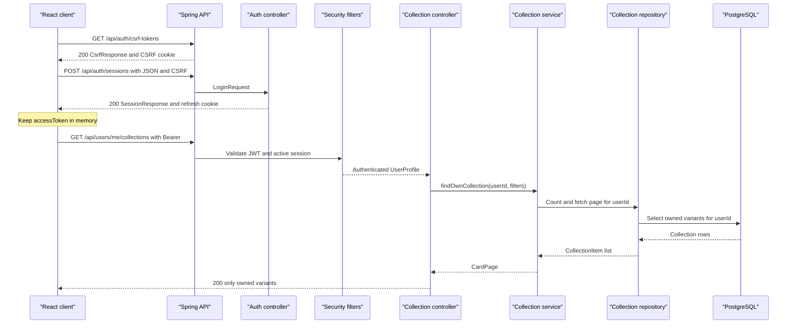

# API backend e collegamento al FrontEnd

Ultimo aggiornamento significativo: **2026-11-16**. Inventario ricavato dai controller e dai contratti F01, F04 e F05 presenti nel repository. Le API indicate come implementate sono disponibili nel backend, ma questo documento non attesta una nuova verifica applicativa. L'integrazione React non è ancora implementata.

Questa pagina raccoglie le informazioni operative per collegare il client alle API esistenti: indirizzi, autenticazione, cookie, CORS, payload principali e codici HTTP. I contratti canonici di autenticazione, carte e mazzi restano rispettivamente [F01](accesso-utenti.md), [F04](collezione-carte.md) e [F05](gestione-mazzi.md).

## Servizi e indirizzi

| Componente | Indirizzo locale | Stato e ruolo |
| --- | --- | --- |
| Backend `spring_app` | `http://localhost:8081` | API Spring MVC implementate per F01, profili, F04 e F05. In Compose la porta host è configurabile. |
| FrontEnd `react` | `http://localhost:8082` | Servizio previsto in Compose; codice e integrazione client non ancora avviati. |
| PostgreSQL `postgres` | `localhost:5432` | Infrastruttura dati; non espone API HTTP al client. |
| `game-engine` | Porta container `8083` | Componente separato previsto in Compose. Non sono stati individuati controller HTTP da integrare nel client. |

Usare l'origine backend come base URL del client, senza aggiungere `/api` alla configurazione: ogni percorso nella tabella seguente è già completo. In locale la base è `http://localhost:8081`; non sono state ancora definite variabili frontend o un proxy di sviluppo. Evitare di confondere `localhost` con `127.0.0.1`: i cookie `__Host-` e la configurazione delle origini dipendono dall'host.

## Matrice tecnologica dei servizi

| Componente | Web e dati | Discovery | Gateway | Health | Cache | Metriche custom |
| --- | --- | --- | --- | --- | --- | --- |
| Backend `spring_app` | Spring MVC; `JdbcClient` e PostgreSQL | Non configurato | Nessuno; chiamata diretta | Actuator health disponibile | Non rilevata | Non rilevate |
| FrontEnd `react` | React previsto; codice applicativo non presente | Non configurato | Nessuno | Non documentato | Non rilevata | Non rilevate |
| PostgreSQL `postgres` | Database relazionale PostgreSQL | DNS interno Compose | Non applicabile | Health check del container | Non applicabile | Non applicabile |
| `game-engine` | Modulo Java separato | Non configurato | Nessuno | Da definire | Non rilevata | Non rilevate |

Con il backend avviato:

- OpenAPI JSON: `http://localhost:8081/v3/api-docs`
- Swagger UI: `http://localhost:8081/swagger-ui/index.html` (è disponibile anche il redirect `/swagger-ui.html`)
- Health check: `http://localhost:8081/actuator/health`

Le API applicative implementate usano il prefisso `/api`. Non è configurato un API gateway: il browser chiama direttamente il backend. Le funzionalità F03, F06, F07, F08 e F10 non hanno endpoint applicativi implementati in questo inventario.

## Regole comuni di collegamento

- I body JSON usano `Content-Type: application/json`; i metodi GET non richiedono un body.
- Tutte le rotte `/api/**` richiedono un bearer JWT valido, salvo gli endpoint pubblici di autenticazione elencati sotto e il bootstrap CSRF. Anche le richieste di accesso/registrazione non devono inviare un JWT vecchio o scaduto.
- Per le rotte protette inviare `Authorization: Bearer <accessToken>`. Il token è restituito nel body di sessione; tenerlo in memoria, non in `localStorage` o `sessionStorage`.
- Il cookie refresh è `HttpOnly`: JavaScript non deve leggerlo. Per le chiamate F01 che creano, ruotano o revocano cookie, il browser deve inviare i cookie con `credentials: "include"`.
- Le scritture F01 richiedono il token CSRF oltre al cookie. Prima chiamare `GET /api/auth/csrf-tokens`; inviare il valore JSON `token` usando il nome header restituito, normalmente `X-XSRF-TOKEN`.
- Le API F04/F05 e `/api/users/**` usano Bearer e non richiedono CSRF.
- Per CORS il backend ammette origini esatte configurate, con credenziali, metodi `GET`, `HEAD`, `POST`, `PUT`, `PATCH`, `DELETE`, `OPTIONS` e header `Authorization`, `Content-Type`, `X-XSRF-TOKEN`. L'origine locale predefinita è `http://localhost:8082`; impostare quella effettiva del browser se diversa.
- I cookie di autenticazione sono `Secure`, `HttpOnly`, `SameSite=Strict`, `Path=/`. Per l'uso browser in distribuzione servono HTTPS e frontend/backend nello stesso sito. Il comportamento dei cookie `Secure` nel proprio setup locale va verificato nel browser.
- Le risposte di sessione e le risposte contenenti credenziali o profilo sono marcate `Cache-Control: no-store`.

### Sequenza di accesso e lettura della collezione



## Inventario degli endpoint applicativi

`Bearer` significa `Authorization: Bearer <accessToken>`. `CSRF` significa cookie CSRF più header `X-XSRF-TOKEN`, usando il nome header restituito dal bootstrap.

| ID | Metodo e percorso | Accesso | Richiesta | Risposta di successo |
| --- | --- | --- | --- | --- |
| F01 | `GET /api/auth/csrf-tokens` | Pubblico | Nessun body | `200 CsrfResponse`; imposta il cookie CSRF. |
| F01 | `POST /api/auth/users` | CSRF, senza Bearer | `RegistrationRequest` | `201 SessionResponse`; imposta il cookie refresh. |
| F01 | `POST /api/auth/sessions` | CSRF, senza Bearer | `LoginRequest` | `200 SessionResponse`; imposta il cookie refresh. |
| F01 | `POST /api/auth/password-reset-requests` | CSRF, senza Bearer | `PasswordResetRequest` | `202 PasswordResetAcknowledgement`. Invio email e consegna token non implementati. |
| F01 | `POST /api/auth/password-resets` | CSRF, senza Bearer | `PasswordResetConfirmation` | `204`, senza body o nuova sessione. |
| F01 | `GET /api/auth/users/me` | Bearer | Nessun body | `200 UserProfile`. |
| F01 | `POST /api/auth/session-renewals` | CSRF e cookie refresh, senza Bearer | Nessun body | `200 SessionResponse`; ruota cookie refresh. |
| F01 | `POST /api/auth/session-revocations` | CSRF e cookie refresh facoltativo, senza Bearer | Nessun body | `204`; revoca la sessione se il cookie è utilizzabile e scade il cookie. |
| F01 | `GET /api/users/{userId}` | Bearer | Path `userId` intero positivo | `200 PublicUserProfile`. |
| F01 | `PATCH /api/users/me` | Bearer | `UserProfileUpdateRequest` | `200 UserProfile` aggiornato. |
| F04 | `GET /api/cards` | Bearer | Query `CardSearchParameters` | `200 CardPage<CardCatalogItem>`. |
| F04 | `GET /api/users/me/collections` | Bearer | Query `CardSearchParameters` | `200 CardPage<CollectionItem>` del chiamante. |
| F05 | `GET /api/users/me/decks` | Bearer | Nessun body | `200 List<DeckListItemResponse>`. |
| F05 | `POST /api/users/me/decks` | Bearer | `CreateDeckRequest`, body facoltativo | `201 DeckDetailsResponse`. |
| F05 | `GET /api/decks/{deckId}` | Bearer | Path `deckId` intero positivo | `200 DeckDetailsResponse`, solo se posseduto. |
| F05 | `PUT /api/decks/{deckId}` | Bearer | `UpdateDeckRequest` | `200 DeckDetailsResponse`, sostituzione atomica. |
| F05 | `DELETE /api/decks/{deckId}` | Bearer | Path `deckId` intero positivo | `204`, solo se posseduto. |

Per profili e mazzi, l'ID del proprietario proviene dal principal autenticato, non da un campo della richiesta. Un ID di mazzo inesistente o altrui restituisce `404`.

## Parametri F04: catalogo e collezione

I parametri seguenti sono facoltativi e combinabili su entrambe le rotte F04.

| Parametro | Valori e comportamento |
| --- | --- |
| `name` | Ricerca parziale senza distinzione tra maiuscole/minuscole; massimo 100 caratteri. |
| `faction`, `rarity`, `type`, `expansion` | Codice esatto del catalogo, confronto senza distinzione tra maiuscole/minuscole; massimo 100 caratteri. |
| `energyMin`, `energyMax` | Intervallo inclusivo del costo energia. |
| `attackMin`, `attackMax` | Intervallo inclusivo dell'attacco. |
| `defenseMin`, `defenseMax` | Intervallo inclusivo della difesa. |
| `powerMin`, `powerMax` | Intervallo inclusivo dei punti potenza. |
| `sort` | `name`, `faction`, `rarity`, `energy`, `attack`, `defense`, `power`; predefinito `name`. |
| `direction` | `asc` o `desc`; predefinito `asc`. |
| `page` | Indice base zero; predefinito `0`. |
| `size` | Da `1` a `100`; predefinito `20`. |

I limiti numerici devono essere non negativi e minore/minimo non può superare il massimo. Un ordinamento o una direzione non ammessi, un intervallo invertito o una paginazione non valida restituiscono `400`. I valori nulli sono ordinati per ultimi. La risposta paginata contiene `items`, `page`, `size`, `totalElements`, `totalPages`.

**Garanzia di proprietà F04:** `/api/cards` elenca le carte di catalogo non cancellate logicamente; `/api/users/me/collections` restituisce solo le righe della collezione associate all'ID del principal autenticato. Ogni riga rappresenta una carta e una variante con contatori `ownedReplica` e `tradableReplica`; non esiste un ID di copia individuale. Una carta presente nel catalogo ma non posseduta non deve apparire nella collezione. Il client non deve ricostruire la collezione filtrando localmente il catalogo.

## Esempi per il client

Il seguente esempio mostra il flusso minimo nel browser. È illustrativo e non presuppone che il progetto React o una libreria HTTP siano già configurati.

```typescript
const apiBaseUrl = "http://localhost:8081";
let accessToken: string | null = null;
let csrfToken: { headerName: string; token: string } | null = null;

async function loadCsrfToken(): Promise<void> {
  const response = await fetch(`${apiBaseUrl}/api/auth/csrf-tokens`, {
    credentials: "include",
  });
  if (!response.ok) {
    throw new Error(`CSRF bootstrap failed: ${response.status}`);
  }
  csrfToken = await response.json();
}

async function login(email: string, password: string): Promise<void> {
  await loadCsrfToken();
  const token = csrfToken;
  if (token === null) {
    throw new Error("CSRF token is unavailable");
  }

  const response = await fetch(`${apiBaseUrl}/api/auth/sessions`, {
    method: "POST",
    credentials: "include",
    headers: {
      "Content-Type": "application/json",
      [token.headerName]: token.token,
    },
    body: JSON.stringify({ email, password }),
  });
  if (!response.ok) {
    throw new Error(`Login failed: ${response.status}`);
  }
  const session: { accessToken: string } = await response.json();
  accessToken = session.accessToken;
}

async function loadMyCollection(): Promise<unknown> {
  if (accessToken === null) {
    throw new Error("Sign-in is required");
  }
  const response = await fetch(`${apiBaseUrl}/api/users/me/collections?page=0&size=20`, {
    headers: { Authorization: `Bearer ${accessToken}` },
  });
  if (!response.ok) {
    throw new Error(`Collection request failed: ${response.status}`);
  }
  return response.json();
}
```

Il tipo `unknown` nell'esempio evita di presentare un modello TypeScript del FrontEnd come già generato o mantenuto dal repository; per i tipi di risposta usare i DTO elencati sotto o generarli dalla specifica OpenAPI.

### Ricerca catalogo

**Richiesta dal client al backend** — i filtri sono parametri query; `GET` non ha body JSON.

```http
GET /api/cards?faction=SAPIENS&rarity=COMMON&energyMin=1&energyMax=3&sort=power&direction=desc&page=0&size=20
Authorization: Bearer <accessToken>
Accept: application/json
```

Una carta contiene `id`, `name`, i riferimenti `faction`, `rarity`, `type`, `expansion`, i valori `energyCost`, `attack`, `defense`, `power` e `artworks`. Un riferimento ha `id`, `code`, `name`; ogni artwork ha `cardArtId`, `artCode`, `imageUrl`. I valori descrittivi/statistici opzionali e `imageUrl` possono essere `null`.

**Risposta dal backend al client (`200 OK`):**

```json
{
  "items": [
    {
      "id": 101,
      "name": "Creatura dimostrativa",
      "faction": {
        "id": 1,
        "code": "SAPIENS",
        "name": "Sapiens"
      },
      "rarity": {
        "id": 1,
        "code": "COMMON",
        "name": "Common"
      },
      "energyCost": 1,
      "attack": null,
      "defense": null,
      "power": 1,
      "type": {
        "id": 1,
        "code": "CREATURE",
        "name": null
      },
      "expansion": null,
      "artworks": [
        {
          "cardArtId": 201,
          "artCode": "STANDARD",
          "imageUrl": null
        }
      ]
    }
  ],
  "page": 0,
  "size": 20,
  "totalElements": 1,
  "totalPages": 1
}
```

### Collezione propria

**Richiesta dal client al backend** — i filtri sono parametri query; `GET` non ha body JSON. Il proprietario è determinato dal bearer token, non da un ID fornito dal client.

```http
GET /api/users/me/collections?name=Rift&sort=name&direction=asc&page=0&size=20
Authorization: Bearer <accessToken>
Accept: application/json
```

Ogni elemento della risposta ha `cardId`, `cardArtId`, `artCode`, `imageUrl`, i campi descrittivi della carta e i contatori `ownedReplica`, `tradableReplica`. `tradableReplica` è il valore persistito e non sottrae gli hold degli scambi.

**Risposta dal backend al client (`200 OK`):**

```json
{
  "items": [
    {
      "cardId": 101,
      "cardArtId": 201,
      "artCode": "STANDARD",
      "imageUrl": null,
      "name": "Creatura dimostrativa",
      "faction": {
        "id": 1,
        "code": "SAPIENS",
        "name": "Sapiens"
      },
      "rarity": {
        "id": 1,
        "code": "COMMON",
        "name": "Common"
      },
      "energyCost": 1,
      "attack": null,
      "defense": null,
      "power": 1,
      "type": {
        "id": 1,
        "code": "CREATURE",
        "name": null
      },
      "expansion": null,
      "ownedReplica": 2,
      "tradableReplica": 1
    }
  ],
  "page": 0,
  "size": 20,
  "totalElements": 1,
  "totalPages": 1
}
```

Il JSON è illustrativo: gli ID e i valori non identificano dati demo inseriti nel database. Statistiche, riferimenti e URL dell'immagine possono essere `null`. Se il giocatore non possiede carte corrispondenti ai filtri, la risposta `200 OK` ha `items: []`, `totalElements: 0` e `totalPages: 0`.

### Creazione di un mazzo

```http
POST /api/users/me/decks
Authorization: Bearer <accessToken>
Content-Type: application/json

{
  "entries": [
    {"cardId": 101, "cardArtId": 201, "destination": "ROUND1"}
  ]
}
```

`entries` può essere omesso o vuoto per creare una bozza vuota. Ogni elemento identifica una singola copia con carta, variante e destinazione; valori accettati per la destinazione: `ROUND1` … `ROUND5`, `EQUIPMENT`. La risposta `201` contiene `DeckDetailsResponse`, incluse le righe persistite e il risultato di validazione corrente. L'esempio è illustrativo, non garantisce che l'ID esista o che il mazzo sia valido.

### Sostituzione di un mazzo

```http
PUT /api/decks/8
Authorization: Bearer <accessToken>
Content-Type: application/json

{
  "entries": [
    {"cardId": 101, "cardArtId": 201, "destination": "ROUND1"}
  ],
  "isChallengeable": false
}
```

La richiesta sostituisce l'intero elenco `entries`. `isChallengeable` omesso o `false` mantiene il mazzo non sfidabile; richiedere `true` è soggetto alla validazione server. La risposta include lo stato e la validazione aggiornati. Gli errori di validazione del mazzo restituiscono `400 application/problem+json` con `errors`, `warnings` e `summary`.

## DTO e contratti di serializzazione

Le classi API Java usano record immutabili dove indicato.

| Funzionalità | Tipi richiesta/query | Tipi risposta |
| --- | --- | --- |
| Autenticazione F01 | `RegistrationRequest`, `LoginRequest`, `PasswordResetRequest`, `PasswordResetConfirmation` | `CsrfResponse`, `SessionResponse`, `PasswordResetAcknowledgement`, `UserProfile` |
| Profili F01 | Path `userId`; `UserProfileUpdateRequest` | `PublicUserProfile`, `UserProfile` |
| Carte F04 | `CardSearchParameters` | `CardPage<T>`, `CardCatalogItem`, `CardArtwork`, `CardReference`, `CollectionItem` |
| Mazzi F05 | `CreateDeckRequest`, `UpdateDeckRequest`, `DeckEntryRequest`; path `deckId` | `DeckListItemResponse`, `DeckDetailsResponse`, `DeckEntryResponse`, `DeckValidationResult`, `DeckViolation`, `DeckSummary` |

Jackson serializza i record in JSON. Non esiste un DTO di aggregazione gateway: controller e servizi appartengono alla stessa applicazione backend. Per forma puntuale e dettagli aggiornati dei payload vedere le specifiche canoniche F01/F04/F05.

## Errori, autorizzazioni e comportamento di rete

| Status | Indicazione per il client |
| --- | --- |
| `400` | Richiesta JSON o parametri non validi, vincoli del mazzo non rispettati. Gli errori MVC usano Problem Details; gli errori F05 di validazione includono anche i dettagli del validatore. |
| `401` | Bearer mancante/non valido oppure credenziali o cookie refresh non utilizzabili. Per Bearer può essere presente `WWW-Authenticate`. Scartare il token e rinnovare o richiedere nuovo accesso secondo F01. |
| `403` | CSRF non valido o accesso non autorizzato (ad esempio ruolo non ammesso a un namespace protetto). I filtri possono non restituire un body Problem Details. |
| `404` | Utente o mazzo non disponibile; include le risorse altrui per le operazioni F05. |
| `409` | Email o nickname già in uso nell'aggiornamento profilo o registrazione. |
| `415` | Tipo contenuto non supportato quando è richiesto JSON. |
| `500` | Errore server o persistenza. Non assumere che una richiesta fallita sia riuscita; per le mutazioni ricaricare lo stato autorevole. |

Per F05 non ripetere automaticamente le mutazioni non idempotenti in caso di timeout senza prima rileggere lo stato. F01 rinnovo e logout vanno serializzati nel client; dopo rinnovo riuscito sostituire il JWT in memoria. Non sono documentati retry automatici, circuit breaker o timeout applicativi per le chiamate HTTP. Non è configurata comunicazione asincrona tra il browser e i servizi per questi flussi.

## Documentazione tecnica e componenti operativi

| Risorsa | Percorso | Accesso |
| --- | --- | --- |
| Documento OpenAPI | `GET /v3/api-docs` | Pubblico |
| Swagger UI | `/swagger-ui/index.html` | Pubblico |
| Health check | `GET /actuator/health` | Pubblico |

Non risultano metriche custom esposte come parte del contratto FrontEnd. Gli endpoint Actuator diversi da health non sono inclusi nella superficie dichiarata al client.

## Sequenza rinnovo sessione

Dopo un reload dell'applicazione o quando il token di accesso non è più utilizzabile, il client ottiene un token CSRF aggiornato, poi chiama il rinnovo senza header Authorization. Il browser invia il cookie refresh; se il rinnovo riesce, il client sostituisce in memoria l'access token.

```http
GET /api/auth/csrf-tokens
```

```http
POST /api/auth/session-renewals
X-XSRF-TOKEN: <token restituito dal bootstrap>
Cookie: __Host-cinder-csrf=<cookie del browser>; __Host-cinder-refresh=<cookie del browser>
```

Non impostare manualmente l'header `Cookie` in JavaScript: usare `credentials: "include"` e lasciare al browser la gestione dei cookie. Un `401` al rinnovo richiede di scartare il token in memoria e chiedere un nuovo accesso.

## Punti non ancora disponibili

- Applicazione React, servizio API del client, schermate e verifica browser.
- Recupero password completo: non esiste ancora la consegna del token via email né il relativo flusso UI.
- API per acquisti/apertura pacchetti, crediti, scambi, sfide, storico e gestione carte da backoffice.
- Il motore Java separato non espone nel codice corrente un contratto HTTP per il client.
- Versionamento URL/API, convenzione uniforme per timeout client e politica di retry devono essere decisi prima di un'integrazione più ampia.

## Collegamenti

- [Indice documentazione BackEnd](README.md)
- [Indice documentazione FrontEnd](../FrontEnd/README.md)
- [F01 — Accesso utenti](accesso-utenti.md)
- [F04 — Catalogo e collezione](collezione-carte.md)
- [F05 — Gestione e validazione dei mazzi](gestione-mazzi.md)
- [Configurazione e avvio backend](../../springboot_app/app/README.md)
- [Composizione locale dei servizi](../../compose.yaml)
- [Indice generale e stato delle funzionalità](../README.md)