# Schema dati preliminare

ID collegati: F01, F03, F04, F05, F06, F07, F08, F10, D01 e D03.  
Perimetro: proposta trasversale da discutere; non concordata.  
Implementazione: non iniziata. Stack definitivo e database da confermare.  
Ultimo aggiornamento significativo: 2026-11-13.  
Verifica: controlli documentali; nessuno schema eseguibile o applicazione disponibile.

## Scopo e limiti

Questo documento propone un modello logico iniziale per mettere in relazione account, catalogo, copie possedute, crediti, offerte e pacchetti, mazzi, scambi e partite. Non è DDL, non sceglie un database e non sostituisce i contratti canonici delle singole pagine BackEnd: serve da base per il confronto e va aggiornato dopo le decisioni condivise.

I nomi inglesi delle entità e dei campi sono proposte coerenti con le convenzioni del progetto. Tipi, cardinalità, vincoli e valori enumerati sono concettuali. Le regole di gioco restano nella [proposta di regolamento](../Digital/regolamento-base.md); prezzi, crediti e composizione commerciale restano da definire in [D03](../Digital/economia-crediti-pacchetti.md).

## Modello concettuale proposto

| Area | Entità e attributi indicativi | Relazioni e note aperte |
| --- | --- | --- |
| Account — F01 | `User`: `id`, `email`, `password_hash`; assegnazioni di ruolo | `email` univoca; memorizzare solo hash della password. I ruoli `ADMIN`, `MANAGER`, `USER` sono confermati, ma cardinalità e permessi non lo sono. |
| Catalogo — F10/D01 | `Card`: `id`, `name`, `kind`, `rarity`, `faction`, statistiche ed effetto | Creature, equipaggiamenti, rarità e statistiche vanno allineati alla proposta Digital e confermati. Versionamento e modifiche alle carte già usate restano da decidere. |
| Collezione — F04 | `OwnedCopy`: `id`, `owner_id`, `card_id`, data e provenienza | Una riga rappresenta una copia identificabile, non solo un conteggio aggregato. Consente a mazzi e scambi di riferirsi alla copia precisa; questo criterio è da concordare. |
| Crediti — F03/F06/D03 | `CreditAccount`: utente e saldo; `CreditEntry`: variazione firmata, causale, riferimento e data | Proposta: registro delle variazioni per ricostruire il saldo; se si memorizza anche un saldo corrente, aggiornarlo insieme al registro. Origine dei crediti, precisione, trasferimenti e rettifiche sono da definire. |
| Offerte e pacchetti — F03/F10 | `Offer`: prezzo in crediti; `OfferPack`: tipo e quantità inclusi; `PackType`; `PackCompositionRule`: rarità e quantità | L'offerta raggruppa pacchetti, mentre la regola di composizione descrive l'estrazione di ciascun pacchetto. Prezzi, tipi, carte garantite, quantità e distribuzione per rarità sono da concordare con Digital. |
| Acquisto e apertura — F03/F04 | `Purchase`: utente, offerta e prezzo registrato al momento dell'acquisto; `PurchasedPack`; `PackOpening`; carte estratte | Conservare il prezzo applicato e collegare ogni risultato alle copie create. Apertura immediata o differita e modalità di estrazione sono da definire. |
| Mazzi — F05 | `Deck`: proprietario e nome; `DeckEntry`: mazzo, copia posseduta e collocazione | La struttura deve rappresentare le assegnazioni richieste dal regolamento dopo la conferma. Uso della stessa copia in più mazzi e conseguenze degli scambi sono da decidere. |
| Scambi — F06 | `Trade`: proponente, destinatario, visibilità, stato e scadenza; righe di carte e crediti con mittente e destinatario | Il perimetro di scambio pubblico/privato, carte e crediti, con consenso di entrambe le parti è confermato. Stati, doppio consenso, prenotazioni, scadenza e regolamento atomico sono da definire. |
| Partite — F07/F08 | `Match`, `MatchParticipant`, `MatchEvent`: partecipanti, mazzi scelti, risultato ed eventi ordinati | Il server simula la partita e lo storico include il resoconto proposto. Formato degli eventi, snapshot dei mazzi e delle carte, stati e conservazione sono da definire. |

### Relazioni principali

```mermaid
erDiagram
    users ||--o| credit_accounts : "has"
    users ||--o{ credit_entries : "owns"
    users ||--o{ owned_copies : "owns"
    cards ||--o{ owned_copies : "defines"
    users ||--o{ purchases : "makes"
    offers ||--o{ purchases : "is selected"
    offers ||--o{ offer_packs : "contains"
    pack_types ||--o{ offer_packs : "is included"
    pack_types ||--o{ pack_composition_rules : "defines"
    purchases ||--|{ purchased_packs : "creates"
    pack_types ||--o{ purchased_packs : "identifies"
    purchased_packs ||--o| pack_openings : "may be opened"
    pack_openings ||--o{ opening_cards : "records"
    owned_copies ||--o| opening_cards : "is created by"
    users ||--o{ decks : "owns"
    decks ||--o{ deck_entries : "contains"
    owned_copies ||--o{ deck_entries : "is referenced by"
    users ||--o{ trades : "proposes"
    users o|--o{ trades : "is invited to"
    trades ||--o{ trade_cards : "includes"
    owned_copies ||--o{ trade_cards : "is exchanged"
    users ||--o{ trade_cards : "sends"
    users ||--o{ trade_cards : "receives"
    trades ||--o{ trade_credits : "includes"
    users ||--o{ trade_credits : "sends"
    users ||--o{ trade_credits : "receives"
    users ||--o{ match_participants : "plays"
    decks o|--o{ match_participants : "is selected for"
    matches ||--|{ match_participants : "has"
    matches ||--o{ match_events : "records"
    users {
        string id PK
        string email UK
        string password_hash
    }
    credit_accounts {
        string user_id PK "also FK to users"
        int balance_credits
    }
    credit_entries {
        string id PK
        string user_id FK
        int amount_credits
        string reason
        string reference_type
        string reference_id
    }
    cards {
        string id PK
        string name
        string kind
        string rarity
        string faction
    }
    owned_copies {
        string id PK
        string owner_id FK
        string card_id FK
    }
    offers {
        string id PK
        int price_credits
    }
    offer_packs {
        string offer_id PK "also FK to offers"
        string pack_type_id PK "also FK to pack_types"
        int quantity
    }
    pack_types {
        string id PK
        string name
    }
    pack_composition_rules {
        string pack_type_id PK "also FK to pack_types"
        string rarity PK
        int quantity
    }
    purchases {
        string id PK
        string user_id FK
        string offer_id FK
        int price_credits
    }
    purchased_packs {
        string id PK
        string purchase_id FK
        string pack_type_id FK
    }
    pack_openings {
        string id PK
        string purchased_pack_id FK
    }
    opening_cards {
        string id PK
        string opening_id FK
        string owned_copy_id FK
    }
    decks {
        string id PK
        string owner_id FK
        string name
    }
    deck_entries {
        string id PK
        string deck_id FK
        string owned_copy_id FK
    }
    trades {
        string id PK
        string proposer_id FK
        string recipient_id FK
        string visibility
        string status
    }
    trade_cards {
        string id PK
        string trade_id FK
        string owned_copy_id FK
        string from_user_id FK
        string to_user_id FK
    }
    trade_credits {
        string id PK
        string trade_id FK
        int amount_credits
        string from_user_id FK
        string to_user_id FK
    }
    matches {
        string id PK
        string status
        string result
    }
    match_participants {
        string match_id PK "also FK to matches"
        string user_id PK "also FK to users"
        string deck_id FK
    }
    match_events {
        string id PK
        string match_id FK
        int sequence_number
        string event_type
    }
```

<!-- mermaid-checked: every attribute is `<type> <name> [<key>] ["<description>"]` with at most one of PK/FK/UK, no \n in descriptions, no {} in descriptions, every relationship label is double-quoted -->

Il diagramma mostra solo i legami essenziali: non fissa schema fisico, chiavi definitive, nullable, indici, vincoli d'unicità composti o formato dei dati degli eventi. Le assegnazioni di ruolo sono omesse perché la loro cardinalità non è decisa. F07 prevede due giocatori; il vincolo esatto dei partecipanti va formalizzato nel contratto. Le tabelle operative e i campi andranno rivisti con gli sviluppatori prima di diventare contratto.

## Percorso acquisto, addebito, apertura e collezione

Per il flusso canonico proposto e i casi di errore, vedere [F03 — Offerte e acquisto di pacchetti](acquisto-pacchetti.md#percorso-acquisto-addebito-estrazione-e-collezione). In sintesi, il modello dati illustra:

- `Purchase` conserva offerta e prezzo applicato, `PurchasedPack` le unità acquistate, `PackOpening` l'esito dell'apertura, `OpeningCard` il collegamento al risultato e `OwnedCopy` le copie nella collezione.
- L'addebito è rappresentabile con una `CreditEntry` associata all'utente e all'acquisto; l'eventuale saldo memorizzato in `CreditAccount` deve restare coerente.
- Atomicità, idempotenza, concorrenza e apertura immediata o differita sono proposte/punti aperti nel contratto F03, non comportamenti implementati.

## Esempi illustrativi per il FrontEnd

Gli esempi sintetici, con identificativi e valori fittizi, sono mantenuti nelle pagine canoniche per evitare copie divergenti: [saldo e risultato dell'apertura in F03](acquisto-pacchetti.md#esempi-di-dati-illustrativi) e [carte possedute in F04](collezione-carte.md#esempio-di-carte-possedute). Non sono endpoint o DTO approvati, prezzi o composizione dei pacchetti.

## Confronti e decisioni da acquisire

- **Andrea e Benedetto:** concordare il modello delle copie, il saldo rispetto al registro crediti, le chiavi e i vincoli, i confini transazionali, la concorrenza, i retry e la conservazione dei dati delle partite.
- **Paolo:** definire la composizione dei pacchetti: quantità, rarità, eventuali carte garantite, criteri di estrazione e gestione dei duplicati. Il modello `PackCompositionRule` è solo un contenitore concettuale per il confronto.
- **Daniele:** usare gli esempi come dati fittizi per predisporre l'integrazione visuale; nomi e forma dei campi vanno confermati quando il contratto BackEnd sarà concordato.

Questi confronti non risultano documentati come già avvenuti. Restano inoltre da confermare stack/database, modalità di assegnazione dei crediti, prezzi, ruoli e permessi, apertura immediata o differita, regole finali del gioco, stato e durata degli scambi, formato degli eventi e politica di conservazione.

## Collegamenti

- [Indice generale e stato delle funzionalità](../README.md#stato-delle-funzionalità)
- [Indice BackEnd](README.md)
- [F01 — Accesso utenti](accesso-utenti.md)
- [F03 — Offerte e acquisto di pacchetti](acquisto-pacchetti.md)
- [F04 — Collezione delle carte](collezione-carte.md)
- [F05 — Gestione dei mazzi](gestione-mazzi.md)
- [F06 — Scambi e marketplace](scambi-mercato.md)
- [F07 — Sfide e simulazione](sfide-simulazione.md)
- [F08 — Storico delle partite](storico-partite.md)
- [F10 — Gestione amministrativa](gestione-amministrativa.md)
- [D01 — Lore, identità e carte](../Digital/lore-identita-carte.md)
- [D03 — Economia dei crediti e dei pacchetti](../Digital/economia-crediti-pacchetti.md)
- [FrontEnd — Negozio delle offerte](../FrontEnd/acquisto-pacchetti.md)
- [FrontEnd — Consultazione della collezione](../FrontEnd/collezione-carte.md)
- [FrontEnd — Mazzi](../FrontEnd/gestione-mazzi.md)
- [Modello di documentazione](../modello-funzionalita.md)
- [Lista di verifica della consegna](../lista-verifica-consegna.md)
